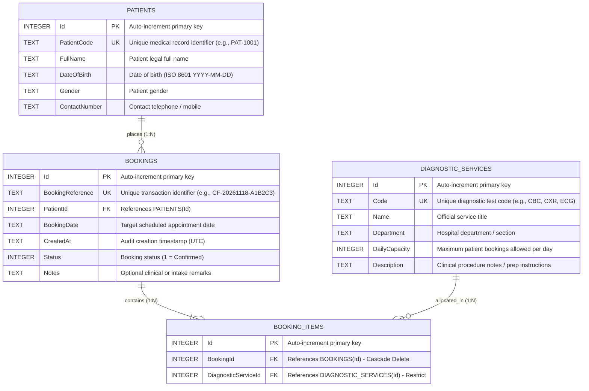

# CareFlow — Relational Database Design

## 1. Overview & Architectural Intent
The CareFlow database schema is designed to represent hospital diagnostic bookings, patient references, diagnostic service catalogs, and line-item allocations while strictly enforcing relational integrity, capacity tracking, and atomic persistence.

This architecture ensures:
1. **Referential Integrity**: Bookings cannot exist without an existing patient (BR-01).
2. **Duplicate Prevention**: A patient cannot have duplicate line items for the same diagnostic service within the same booking (BR-06).
3. **Dynamic Capacity Consistency**: Remaining daily booking capacities are derived directly from persisted records, preventing drift between stored counters and actual booking records (BR-04, BR-05, BR-08).
4. **Permanent Confirmed State**: Records persist across application executions using SQLite (BR-09, AC-06).

---

## 2. Entity Relationship Diagram (ERD)



---

## 3. Entity Dictionary & Schema Specification

### 3.1. `Patients` Table
Stores fictional patient identity and demographic information.

| Column | Data Type | Nullable | Constraints | Description |
| :--- | :--- | :---: | :--- | :--- |
| `Id` | `INTEGER` | No | `PRIMARY KEY AUTOINCREMENT` | Internal synthetic identifier. |
| `PatientCode` | `TEXT` | No | `UNIQUE`, Max length: 20 | Unique hospital patient reference code. |
| `FullName` | `TEXT` | No | Max length: 150 | Legal name of patient. |
| `DateOfBirth` | `TEXT` | No | Format: `YYYY-MM-DD` | Date of birth. |
| `Gender` | `TEXT` | Yes | Max length: 20 | Biological sex / gender. |
| `ContactNumber`| `TEXT` | Yes | Max length: 30 | Contact phone number. |

### 3.2. `DiagnosticServices` Table
Catalog of hospital outpatient diagnostic tests and daily booking limits.

| Column | Data Type | Nullable | Constraints | Description |
| :--- | :--- | :---: | :--- | :--- |
| `Id` | `INTEGER` | No | `PRIMARY KEY AUTOINCREMENT` | Internal synthetic identifier. |
| `Code` | `TEXT` | No | `UNIQUE`, Max length: 20 | Test code (e.g. `CBC`, `ECG`, `CXR`). |
| `Name` | `TEXT` | No | Max length: 150 | Descriptive name of the service. |
| `Department` | `TEXT` | Yes | Max length: 100 | Clinical section (Hematology, Radiology, etc.). |
| `DailyCapacity` | `INTEGER` | No | Check: `>= 1` | Maximum allowed bookings per calendar date. |
| `Description` | `TEXT` | Yes | Max length: 300 | Procedure description or prep notes. |

### 3.3. `Bookings` Table
Header entity for diagnostic booking transactions.

| Column | Data Type | Nullable | Constraints | Description |
| :--- | :--- | :---: | :--- | :--- |
| `Id` | `INTEGER` | No | `PRIMARY KEY AUTOINCREMENT` | Internal synthetic identifier. |
| `BookingReference` | `TEXT` | No | `UNIQUE`, Max length: 40 | Public confirmation code (`CF-YYYYMMDD-XXXXXX`). |
| `PatientId` | `INTEGER` | No | `FOREIGN KEY -> Patients(Id)` | Reference to existing patient (`RESTRICT` on delete). |
| `BookingDate` | `TEXT` | No | Format: `YYYY-MM-DD` | Scheduled calendar date for tests. |
| `CreatedAt` | `TEXT` | No | ISO 8601 UTC timestamp | Audit trail timestamp when confirmed. |
| `Status` | `INTEGER` | No | `Default = 1 (Confirmed)` | State flag. |
| `Notes` | `TEXT` | Yes | Max length: 500 | Intake remarks or fasting instructions. |

### 3.4. `BookingItems` Table
Join entity representing multi-service line items within a booking.

| Column | Data Type | Nullable | Constraints | Description |
| :--- | :--- | :---: | :--- | :--- |
| `Id` | `INTEGER` | No | `PRIMARY KEY AUTOINCREMENT` | Line item identifier. |
| `BookingId` | `INTEGER` | No | `FOREIGN KEY -> Bookings(Id)` | Header booking reference (`CASCADE` on delete). |
| `DiagnosticServiceId` | `INTEGER` | No | `FOREIGN KEY -> DiagnosticServices(Id)` | Service reference (`RESTRICT` on delete). |

#### Unique Composite Index
- **Index**: `IX_BookingItems_BookingId_DiagnosticServiceId` ON `(BookingId, DiagnosticServiceId)` (`UNIQUE`).
- **Enforcement**: Guarantees that the same diagnostic service cannot be added more than once to a single booking request at the database engine level (BR-06).

---

## 4. Relational Rules & Transactional Guarantees

### 4.1. Capacity Derivation (BR-04, BR-05, AC-01)
Capacity is calculated deterministically from persisted records:
```sql
SELECT 
    s.Id,
    s.Code,
    s.Name,
    s.DailyCapacity,
    COUNT(bi.Id) AS BookedCount,
    (s.DailyCapacity - COUNT(bi.Id)) AS RemainingCapacity
FROM DiagnosticServices s
LEFT JOIN BookingItems bi ON s.Id = bi.DiagnosticServiceId
LEFT JOIN Bookings b ON bi.BookingId = b.Id AND b.BookingDate = @TargetDate
GROUP BY s.Id, s.Code, s.Name, s.DailyCapacity;
```

### 4.2. Atomic Transaction Boundary (BR-07, BR-08, AC-04, AC-05)
Every booking insertion executes within an explicit `IDbContextTransaction`:
1. Start database transaction: `await _dbContext.Database.BeginTransactionAsync()`
2. For each requested service ID:
   - Query current bookings count on `TargetDate`.
   - Validate `CurrentBookedCount + 1 <= DailyCapacity`.
   - If capacity is exceeded, abort and roll back immediately.
3. Insert `Booking` header.
4. Insert 1 to 3 `BookingItem` line items.
5. Save changes: `await _dbContext.SaveChangesAsync()`.
6. Commit transaction: `await transaction.CommitAsync()`.
7. If any error or simulated failure occurs before Step 6, `await transaction.RollbackAsync()` is executed. Zero partial records remain in the database.
