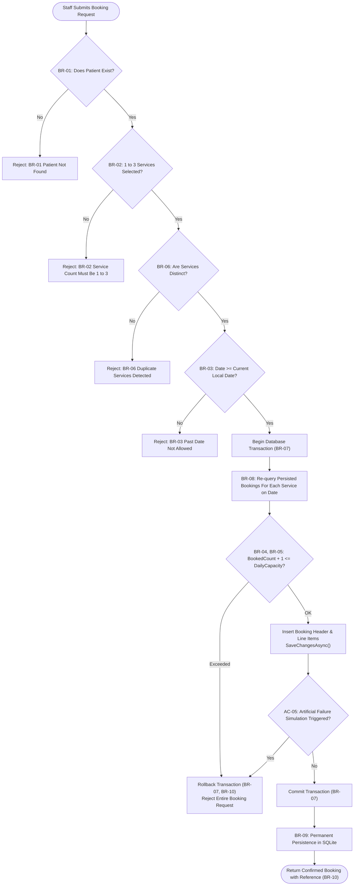

# CareFlow — Full Step-by-Step Process & Architecture Guide

> **Course Component**: ITSD81 - Desktop Application Development (Lecture)  
> **Unit**: IV - Data-Driven Application Architecture and Transactional Workflows  
> **Project**: CareFlow - Outpatient Diagnostic Booking Management  

---

## 1. Executive Summary & Objective

CareFlow is a modern desktop application engineered for hospital outpatient diagnostic departments. When patients visit an outpatient department, they frequently require a cluster of diagnostic services (e.g., Complete Blood Count, Urinalysis, Chest X-Ray, ECG) scheduled for the same calendar date.

However, clinical diagnostic equipment, reagents, and radiology personnel operate under strict **daily capacity limits**. A fundamental operational hazard in hospital software is **partial booking failure**: if a system books 2 out of 3 requested services because the 3rd service was at full capacity, the patient arrives with an incomplete requisition, causing medical workflow breakdowns.

The goal of this project is to implement an enterprise-grade desktop application using **C#, .NET, Avalonia UI (MVVM), and Entity Framework Core with SQLite** that demonstrates:
1. **Business rules separation** from UI event handlers.
2. **Relational consistency** between patients, service catalogs, and line-item bookings.
3. **Atomic transaction management** (`IDbContextTransaction`) where all requested services are booked together or none are committed.
4. **Dynamic capacity derivation** to eliminate synchronization drift.
5. **Persistence guarantees** that survive application restarts.

---

## 2. Requirement Analysis & Business Rules Specification

The project strictly fulfills all 10 mandatory business rules defined in Section V of the specification:



### Business Rules Summary Table
* **BR-01**: Each booking must reference an existing patient.
* **BR-02**: Each booking must contain 1 to 3 distinct diagnostic services.
* **BR-03**: The booking date cannot be earlier than the current local date.
* **BR-04**: Each selected service consumes 1 unit of daily capacity.
* **BR-05**: Confirmed bookings cannot exceed the daily capacity of a diagnostic service.
* **BR-06**: The same service cannot appear more than once in a booking request.
* **BR-07**: All required booking changes must be committed together, or none must be committed.
* **BR-08**: Availability must be rechecked when the booking is confirmed, rather than relying solely on previously displayed information.
* **BR-09**: Confirmed booking information must persist between application executions.
* **BR-10**: Invalid requests and unsuccessful database operations must produce understandable feedback.

---

## 3. Relational Architecture & Entity Model

The relational model separates immutable identity, service capabilities, transaction headers, and line items:

### 3.1. Entities
1. **`Patient`**:
   - `Id` (Primary Key, integer identity)
   - `PatientCode` (Unique text e.g., `PAT-1001`)
   - `FullName`, `DateOfBirth`, `Gender`, `ContactNumber`
2. **`DiagnosticService`**:
   - `Id` (Primary Key, integer identity)
   - `Code` (Unique text e.g., `CBC`, `ECG`, `CXR`, `URN`)
   - `Name`, `Department`, `DailyCapacity`, `Description`
3. **`Booking`**:
   - `Id` (Primary Key, integer identity)
   - `BookingReference` (Unique text e.g., `CF-20261118-A1B2C3`)
   - `PatientId` (Foreign Key -> `Patient.Id`, `DeleteBehavior.Restrict`)
   - `BookingDate` (`DateOnly`)
   - `CreatedAt` (`DateTime` UTC)
   - `Status` (`BookingStatus.Confirmed`)
   - `Notes` (Optional clinical instructions)
4. **`BookingItem`**:
   - `Id` (Primary Key)
   - `BookingId` (Foreign Key -> `Booking.Id`, `DeleteBehavior.Cascade`)
   - `DiagnosticServiceId` (Foreign Key -> `DiagnosticService.Id`, `DeleteBehavior.Restrict`)
   - **Composite Unique Index**: `(BookingId, DiagnosticServiceId)` ensuring at database level that duplicate services cannot be attached to one booking.

### 3.2. Why Dynamic Capacity Calculation Was Chosen
Rather than storing a volatile `RemainingSlots` counter column on `DiagnosticService` (which is vulnerable to drift, out-of-sync states, and concurrency anomalies), CareFlow computes capacity on-the-fly from the persisted line items:
$$\text{Remaining Capacity}(s, d) = \text{DailyCapacity}(s) - \sum \text{BookingItems}(s, d)$$
This guarantees mathematical consistency with zero state drift.

---

## 4. Software Architecture & Separation of Concerns

```text
┌─────────────────────────────────────────────────────────────┐
│                       Presentation Layer                    │
│   MainWindow.axaml       NewBookingView.axaml              │
│   AvailabilityView.axaml BookingHistoryView.axaml          │
│                                                             │
│   MainViewModel          NewBookingViewModel                │
│   AvailabilityViewModel  BookingHistoryViewModel            │
└──────────────────────────────┬──────────────────────────────┘
                               │ Invokes Service Interfaces
                               ▼
┌─────────────────────────────────────────────────────────────┐
│                    Application / Domain Layer               │
│   IBookingService          BookingService                   │
│   IDiagnosticCatalogService DiagnosticCatalogService        │
│   IPatientService          PatientService                   │
│   Domain Exceptions        (Validation, CapacityExceeded)   │
└──────────────────────────────┬──────────────────────────────┘
                               │ Interacts through DbContext
                               ▼
┌─────────────────────────────────────────────────────────────┐
│                     Persistence Layer (EF Core)             │
│   CareFlowDbContext        DbInitializer                    │
│   EF Core Migrations       careflow.db (SQLite)             │
└─────────────────────────────────────────────────────────────┘
```

### Strict Separation Rules Followed:
1. **Views and ViewModels never directly reference `CareFlowDbContext` or database connection strings.** They only interact with abstracted service interfaces (`IBookingService`, `IDiagnosticCatalogService`, `IPatientService`).
2. **Business validation and transaction lifecycles live exclusively in `BookingService`.** Even if a developer bypasses the UI, the service layer rejects invalid operations and enforces atomicity.
3. **Asynchronous Execution (`async`/`await`)**: All disk and database I/O operations are non-blocking, ensuring UI responsiveness.

---

## 5. Chronological Implementation Steps

### Phase 1: Environment & Solution Setup
1. **Solution Structure**: Created `CareFlow.sln` and `CareFlow.slnx` under `LAB4/CareFlow/`.
2. **Desktop Project**: Generated Avalonia MVVM application targeting `.NET 10` with C# 13 and `CommunityToolkit.Mvvm`.
3. **Test Project**: Created `CareFlow.Tests` with xUnit referencing the core application.

### Phase 2: Package Management & Dependencies
Added production dependencies:
* `Microsoft.EntityFrameworkCore.Sqlite` (v9.0.2)
* `Microsoft.EntityFrameworkCore.Design` (v9.0.2)
* `Microsoft.Extensions.DependencyInjection`
* `CommunityToolkit.Mvvm` (v8.4.2)
* Configured `<ImplicitUsings>enable</ImplicitUsings>` and clean warning management.

### Phase 3: Domain Models & Custom Exceptions
* Implemented `Patient.cs`, `DiagnosticService.cs`, `Booking.cs`, `BookingItem.cs`, and `BookingStatus.cs`.
* Created specialized domain exceptions:
  * `CareFlowValidationException`: Embeds the specific business rule ID (e.g. `BR-01`, `BR-02`, `BR-03`).
  * `ServiceCapacityExceededException`: Specialization for `BR-05` indicating service name, ID, and target date.

### Phase 4: EF Core Data Layer & Migrations
* Implemented `CareFlowDbContext.cs` with Fluent API mappings, indices, foreign keys, and delete behaviors.
* Implemented `CareFlowDbContextFactory.cs` for design-time CLI migration support.
* Generated the initial reproducible EF Core migration: `InitialCreate`.
* Created `DbInitializer.cs` to automatically apply migrations and seed realistic clinical diagnostic services and patients.

### Phase 5: Business Services & Atomic Transactions
* **`BookingService.cs`**:
  - Implements `CreateBookingAsync()` using an explicit `await using var transaction = await _dbContext.Database.BeginTransactionAsync()`.
  - Re-evaluates live capacity within the transaction boundary (BR-08).
  - Enforces all-or-nothing atomicity (BR-07).
  - Includes a controlled simulation parameter (`SimulateFailureBeforeCommit`) to prove rollback behavior (AC-05).
* **`DiagnosticCatalogService.cs`**:
  - Computes daily booked counts and remaining capacity.
* **`PatientService.cs`**:
  - Provides read-only access to existing patient registries.

### Phase 6: Presentation Layer (Avalonia MVVM)
* **`NewBookingViewModel.cs`**: Manages patient selection, date binding, service multi-selection (1 to 3 limit), real-time capacity updates, and feedback banners.
* **`AvailabilityViewModel.cs`**: Dedicated viewmodel for inspecting daily service capacities across any date.
* **`BookingHistoryViewModel.cs`**: Master-detail viewmodel displaying all confirmed bookings and line items.
* **`MainViewModel.cs`**: Coordinates child viewmodels and orchestrates automatic tab updates when bookings are confirmed.

### Phase 7: Automated Verification Test Suite
* Authored 12 xUnit tests covering:
  - Acceptance scenarios **AC-01 through AC-06**.
  - Business rules **BR-01 through BR-10**.
  - In-memory SQLite transaction testing and session-restart file persistence testing.

---

## 6. Acceptance Criteria Verification Guide

Evaluators or instructors can verify each acceptance scenario as follows:

### AC-01: View Diagnostic Services For a Selected Date
* **Requirement**: Remaining capacity is correctly calculated from persisted information.
* **Verification**:
  1. Open the application and navigate to the **Service Availability** tab.
  2. Pick any future date. The screen displays all 6 services with their daily limit and remaining slots.
  3. Automated test: Run `dotnet test --filter AC01`.

### AC-02: Multi-Service Booking Creation
* **Requirement**: One confirmed booking is recorded, including every selected service.
* **Verification**:
  1. On the **Create Booking** tab, select patient `Maria Clara Santos`.
  2. Select 3 services (e.g., `CBC`, `URN`, `CXR`).
  3. Click **Confirm Booking**.
  4. Observe the green confirmation banner with unique booking reference `CF-YYYYMMDD-XXXXXX`.
  5. Check the **Booking History** tab to view the booking and its 3 child diagnostic service items.
  6. Automated test: Run `dotnet test --filter AC02`.

### AC-03: Rejection of Invalid or Fully Booked Requests
* **Requirement**: Request is rejected without creating incomplete or invalid records.
* **Verification**:
  1. Attempt to confirm a booking with **0 services** selected. A red banner displays: `BR-02 Violation: Each booking must contain between 1 and 3 diagnostic services.`
  2. Attempt to select a past date. A red banner displays: `BR-03 Violation: Selected booking date cannot be in the past.`
  3. When a service is at 0 capacity, submitting it displays: `[BR-05] Confirmed bookings cannot exceed service capacity.`
  4. Automated test: Run `dotnet test --filter AC03`.

### AC-04: Stale Capacity & Overbooking Prevention
* **Requirement**: Attempt a booking after previously displayed capacity becomes unavailable. System revalidates and prevents overbooking.
* **Verification**:
  1. On the **Create Booking** tab, check the checkbox for `ECG` (daily limit: 2).
  2. In the **Verification Scenarios Sandbox**, click **"AC-04: Exhaust capacity in background"**. This books the remaining slots for other patients without refreshing the current screen (leaving the display stale).
  3. Click **"Confirm Booking"**.
  4. The system executes the booking service transaction, detects that actual database capacity is now 0, aborts the operation, rolls back, and displays an informative error.
  5. Automated test: Run `dotnet test --filter AC04`.

### AC-05: Database Operation Failure & Atomic Rollback
* **Requirement**: A required database operation fails before a booking is committed. No partial booking or incorrect capacity change is persisted.
* **Verification**:
  1. On the **Create Booking** tab, select a patient and 2 services.
  2. Check **"AC-05: Force failure before commit (Tests atomic rollback)"**.
  3. Click **"Confirm Booking"**.
  4. An intentional exception is thrown right before `CommitAsync()`.
  5. The UI displays: `AC-05 Verified! Transaction Rolled Back... Database state remains consistent (0 partial records written).`
  6. Check **Booking History** — zero records were saved. Service capacities remain completely unchanged.
  7. Automated test: Run `dotnet test --filter AC05`.

### AC-06: Persistence Across Application Restart
* **Requirement**: Close and restart the application after confirming a booking. Previously recorded bookings remain available.
* **Verification**:
  1. Create and confirm a booking.
  2. Note the booking reference (e.g. `CF-20261118-XXXX`).
  3. Close the application window.
  4. Relaunch via `dotnet run --project src/CareFlow`.
  5. Open **Booking History**. The booking, patient details, and service line items remain persisted in `careflow.db`.
  6. Automated test: Run `dotnet test --filter AC06`.

---

## 7. Command Reference

| Action | Command |
| :--- | :--- |
| **Restore packages** | `dotnet restore CareFlow.sln` |
| **Compile solution** | `dotnet build CareFlow.sln` |
| **Run unit & integration tests** | `dotnet test CareFlow.sln` |
| **Launch desktop application** | `dotnet run --project src/CareFlow` |
| **Apply EF Core migrations** | `dotnet ef database update --project src/CareFlow --startup-project src/CareFlow` |
